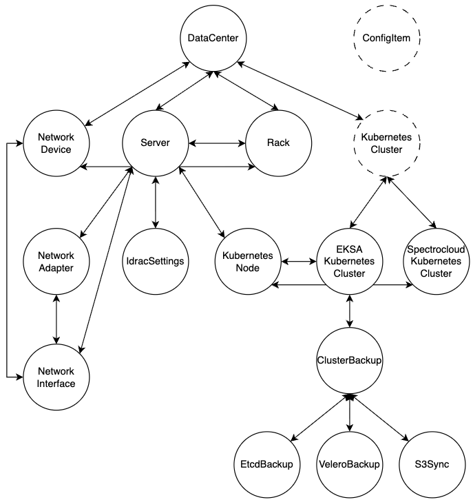

# Orbital API Cheatsheet

Copy-paste GraphQL and REST for services calling orbital on AKS dev. Change requests and approval policies: [`api-cheatsheet-change-control.md`](api-cheatsheet-change-control.md).

## Setup

| | |
|---|---|
| Base URL | `http://ilb.devnew.armada.internal/orbital` |
| GraphQL | `/graphql` |
| REST | `/api/v1` — full parameter reference at `$ORBITAL_URL/swagger/index.html` |
| Auth | `Authorization: Bearer <token>` on every request. AEP forwards the user's Keycloak token. |
| Key | `orbId` (`namespace:name`) — stable. Never cache DGraph UIDs. |

```bash
export ORBITAL_URL=http://ilb.devnew.armada.internal/orbital
export TOKEN=<your bearer token>

# smoke test — lists data centers
curl -s -X POST $ORBITAL_URL/graphql -H "Authorization: Bearer $TOKEN" -H "Content-Type: application/json" \
-d '{"query":"query { queryDataCenter { orbId name } }"}' | jq .
```

## Schema

Example visual reference. For complete schema, see [schema.graphql](/schema/schema.graphql).

<p align="center"></p>

## Data centers

### Look up by asset ID
```graphql
query { queryDataCenter(filter: { assetDataV2: { regexp: "/<asset_id>/" } }) { orbId name assetDataV2 } }
```

### List the models
```graphql
query { __type(name: "DataCenterModel") { enumValues { name } } }
```

```json
# response
{ "data": { "__type": { "enumValues": [
  { "name": "Beacon" }, { "name": "Cruiser" }, { "name": "Triton" }, { "name": "Leviathan" } ] } } }
```

### Look up by model
```graphql
query { queryDataCenter(filter: { model: { eq: Beacon } }) { orbId name model } }
```

### Update model

```graphql
# mutation
mutation UpdateDataCenter($orbId: String!, $set: DataCenterPatch!) {
  updateDataCenter(input: { filter: { orbId: { eq: $orbId } }, set: $set }) {
    numUids dataCenter { orbId name model version updatedBy }
  }
}

# variables
{ "orbId": "demo:demo-galleon", "version": 1, "set": { "model": "Leviathan" } }

# response
{ "data": { "updateDataCenter": { "numUids": 1, "dataCenter": [
  { "orbId": "demo:demo-galleon", "name": "demo-galleon", "model": "Leviathan",
    "version": 2, "updatedBy": "admin@armada.ai" } ] } } }
```

## Racks

### Rack topology — the racks in a data center and the servers in each, by U position

```graphql
# query
query {
  getDataCenter(orbId: "2f-uae:datacenter-2f-uae") {
    orbId name
    racks {
      orbId name uHeight
      servers(order: { asc: rackPosition }) { orbId hostname rackPosition uHeight }
    }
  }
}

# response (one rack shown)
{ "data": { "getDataCenter": { "orbId": "2f-uae:datacenter-2f-uae", "name": "2f-uae", "racks": [
  { "orbId": "2f-uae:rack-Rack-3", "name": "Rack-3", "uHeight": 42, "servers": [
    { "orbId": "2f-uae:server-5HSC3D4", "hostname": "r03-u23.2f-uae", "rackPosition": 23, "uHeight": 1 },
    { "orbId": "2f-uae:server-6MLN3D4", "hostname": "r03-u24.2f-uae", "rackPosition": 24, "uHeight": 1 },
    { "orbId": "2f-uae:server-9MLN3D4", "hostname": "r03-u25.2f-uae", "rackPosition": 25, "uHeight": 1 } ] } ] } } }
```

A rack also holds network devices: add `networkDevices(order: { asc: rackPosition }) { orbId name role rackPosition }` beside `servers`.

## Servers

### List servers in a data center
```graphql
query {
  getDataCenter(orbId: "houston:houston-galleon") {
    servers { orbId name hostname model serviceTag serialNumber rackPosition }
  }
}
```

### Fetch a server's iDRAC settings
```graphql
query {
  getServer(orbId: "houston:BB52FZ3") {
    orbId name
    idracSettings {
      orbId sshEnabled ipmiEnabled dhcpEnabled racadmEnabled
    }
  }
}
```

### Update iDRAC settings — by the `idracSettings.orbId` from the fetch above

```graphql
# mutation
mutation UpdateIdracSettings($orbId: String!, $set: IdracSettingsPatch!) {
  updateIdracSettings(input: { filter: { orbId: { eq: $orbId } }, set: $set }) { numUids }
}

# variables
{ "orbId": "houston:BB52FZ3-idrac", "version": 7, "set": { "sshEnabled": false } }
```

### Update a server field

```graphql
# mutation
mutation UpdateServer($orbId: String!, $set: ServerPatch!) {
  updateServer(input: { filter: { orbId: { eq: $orbId } }, set: $set }) { numUids }
}

# variables
{ "orbId": "houston:server-BB52FZ3", "version": 1, "set": { "serialNumber": "MXFC400359006Z" } }
```

## Clusters

### List EKSA clusters in a data center
```graphql
query {
  getDataCenter(orbId: "houston:houston-galleon") {
    kubernetesClusters {
      ... on EksaKubernetesCluster { orbId name clusterType provider }
    }
  }
}
```

### Fetch a cluster's backup config — by cluster orbId
```graphql
query {
  getEksaKubernetesCluster(orbId: "colo:dev-main") {
    backup {
      orbId
      etcd   { orbId schedule enabled location retentionDays }
      velero { orbId schedule enabled location retentionDays }
    }
  }
}
```

### Update a backup config — by the `etcd`/`velero` orbId from the fetch above

```graphql
# mutation
mutation UpdateEtcdBackup($orbId: String!, $set: EtcdBackupPatch!) {
  updateEtcdBackup(input: { filter: { orbId: { eq: $orbId } }, set: $set }) { numUids }
}

# variables
{ "orbId": "colo:dev-main-etcd-backup", "version": 2, "set": { "schedule": "0 */6 * * *", "retentionDays": 7 } }
```

### The same, as one curl

```bash
# curl
curl -s -X POST $ORBITAL_URL/graphql -H "Authorization: Bearer $TOKEN" -H "Content-Type: application/json" \
-d '{
  "query": "mutation UpdateVeleroBackup($orbId: String!, $set: VeleroBackupPatch!) { updateVeleroBackup(input: { filter: { orbId: { eq: $orbId } }, set: $set }) { numUids veleroBackup { orbId retentionDays version updatedAt updatedBy } } }",
  "variables": { "orbId": "colo:dev-main-velero-backup", "version": 5, "set": { "retentionDays": 14 } }
}' | jq .

# response
{ "data": { "updateVeleroBackup": { "numUids": 1, "veleroBackup": [
  { "orbId": "colo:dev-main-velero-backup", "retentionDays": 14, "version": 30,
    "updatedAt": "2026-07-28T19:13:50Z", "updatedBy": "daniel.nguyen@armada.ai" } ] } } }
```

## Network devices

| Type | Is | Writable |
|---|---|---|
| `NetworkAdapter` | a NIC card (Redfish `NetworkAdapter`) | no — Redfish-sourced |
| `NetworkInterface` | a port: MAC, `linkSpeedMbps`. The BMC/iDRAC is one too: `mgmtOnly: true`, no adapter | no — Redfish-sourced |
| `NetworkDevice` | a switch, firewall or router (NetBox device + `role`) | yes |

- A port links to its `Server` directly and to its card through `networkAdapter`. The card is absent for the BMC, LAGs and NetBox-only sources.
- `connectedNetworkDevice` / `connectedNetworkDevicePort` mean *cabled to* (NetBox `connected_endpoints`), not owned by.
- `macAddress` is the join key between Redfish and NetBox.

### List a server's NICs — by server orbId
```graphql
query {
  getServer(orbId: "colo:CFRHDX3") {
    orbId name
    # data NICs, grouped by card
    networkAdapters {
      orbId name manufacturer model serialNumber
      networkInterfaces {
        orbId name macAddress portType linkSpeedMbps
        connectedNetworkDevicePort
        connectedNetworkDevice { orbId name role }
      }
    }
    # the BMC / iDRAC
    networkInterfaces(filter: { mgmtOnly: true }) {
      orbId name macAddress portType linkSpeedMbps mgmtOnly
    }
  }
}
```

### List network devices in a data center — by DC orbId
```graphql
query {
  getDataCenter(orbId: "colo:colo-galleon") {
    networkDevices { orbId name manufacturer model serial role macAddress }
  }
}
```

### Fetch one device and the servers cabled to it — by device orbId
```graphql
query {
  getNetworkDevice(orbId: "colo:network-device-XH3123090344") {
    orbId name manufacturer model serial role macAddress
    dataCenter { orbId name }
    networkInterfaceConnectedNetworkDevice {
      connectedNetworkDevicePort
      networkAdapter { server { orbId name } }
    }
  }
}
```

### Edit a network device

```graphql
# mutation
mutation UpdateNetworkDevice($orbId: String!, $set: NetworkDevicePatch!) {
  updateNetworkDevice(input: { filter: { orbId: { eq: $orbId } }, set: $set }) {
    numUids networkDevice { orbId role version updatedBy }
  }
}

# variables
{ "orbId": "colo:network-device-XH3123090344", "version": 1, "set": { "role": "core" } }
```

### Add a network device

Pass the input as a variable — orbital sets `version: 1` and stamps `createdBy`/`createdAt`. `dataCenter` links by `orbId`.

```graphql
# mutation
mutation AddNetworkDevice($input: [AddNetworkDeviceInput!]!) {
  addNetworkDevice(input: $input) {
    numUids networkDevice { orbId version createdBy createdAt }
  }
}

# variables
{ "input": [ {
  "orbId": "colo:network-device-JX3623130496",
  "namespace": "colo",
  "name": "Colo_OOB_SW1",
  "manufacturer": "Juniper",
  "model": "EX2300-48T",
  "serial": "JX3623130496",
  "role": "tor",
  "macAddress": "C8:13:37:AA:F0:27",
  "dataCenter": { "orbId": "colo:colo-galleon" }
} ] }
```

## Audit log (REST)

`GET /api/v1/audit-log` — read-only. Orbital writes an event for every change to intent; events are append-only. What that does and doesn't guarantee: [`audit-model.md`](audit-model.md).

### Every edit to one resource, newest first

```bash
# curl
curl -s "$ORBITAL_URL/api/v1/audit-log?orbId=colo:dev-main-velero-backup&limit=50" \
  -H "Authorization: Bearer $TOKEN" | jq .

# response
{
  "events": [
    {
      "id": "3d6bb15f-8c4c-45f0-8a6c-939b6f9cc512",
      "createdAt": "2026-07-28T19:13:50Z",
      "actor": "asharma@armada.ai",
      "operations": ["updateVeleroBackup"],
      "resourceTypes": ["VeleroBackup"],
      "resourceIds": ["colo:dev-main-velero-backup"],
      "eventCategory": "data",
      "changes": [ { "field": "retentionDays", "before": 7, "after": 15 } ],
      "details": { "operationName": "UpdateVeleroBackup", "before": { … }, "variables": { "set": { … } } }
    }
  ],
  "total": 42
}
```

### Filters

All optional, all combinable. None gives the full log.

| Param | Matches |
|---|---|
| `orbId=colo:dev-main-velero-backup` | events touching a resource (repeatable, max 128) |
| `operation=updateVeleroBackup` | one operation name |
| `type=Server` | resource type (repeatable) |
| `namespace=colo` | everything in a data center |
| `createdAt_gte` / `createdAt_lte` | RFC3339 window. Encode `+` as `%2B`, or use `Z` |
| `limit` / `offset` | pagination, `limit` ≤ 500 |

Every list endpoint filters time the same way: `<field>_gte` / `<field>_lte` (`_gt` / `_lt` exclusive).

### Render a diff

`changes` is `{ field, before, after }` with typed values — the same diff orbital's UI shows. It is present only for a single-entity update; creates, bulk adds and multi-operation events omit it.

```js
if (event.changes) event.changes.forEach(c => renderRow(c.field, c.before, c.after))
else               renderSummary(event.operations, event.resourceIds)
```

### Was this change reviewed?

An event carries `authorization` when the write passed a control. Absent means it was written directly.

| `authorization.type` | `id` | Written when |
|---|---|---|
| `changeRequest` | e.g. `colo-58` — open it at `GET /api/v1/change-requests/colo-58` | a change request is merged |
| `divergenceResolution` | the divergence entry's uuid | a divergence is accepted |

```bash
# curl — only the reviewed edits (the filter is client-side)
curl -s "$ORBITAL_URL/api/v1/audit-log?orbId=colo:CFRHDX3-idrac&limit=50" \
  -H "Authorization: Bearer $TOKEN" | jq '[.events[] | select(.authorization)]'

# response
[ { "createdAt": "2026-10-07T14:22:08.418293Z", "actor": "daniel.nguyen@armada.ai",
    "operations": ["updateIdracSettings"],
    "authorization": { "type": "changeRequest", "id": "colo-58" } } ]
```

- `actor` is whoever merged. Who approved is on the change request (`reviewHistory`).
- A five-item change request writes five events, each carrying the same id.

## Export and publish a data center (REST)

```bash
# trigger — exports and publishes to OCI
curl -s -X POST $ORBITAL_URL/api/v1/export -H "Authorization: Bearer $TOKEN" -H "Content-Type: application/json" \
  -d '{"orbId":"houston:houston-galleon"}'

# poll
curl -s $ORBITAL_URL/api/v1/export/jobs/<jobId> -H "Authorization: Bearer $TOKEN" | jq '{status, phase, published}'
```

## Show what is already proposed

Two calls, in parallel, joined on `orbId`.

```bash
# 1. the entities you render, with their owned children
curl -s $ORBITAL_URL/graphql -H "Authorization: Bearer $TOKEN" -H "Content-Type: application/json" -d '{"query":"
  { getServer(orbId:\"colo:server-CWJHDX3\") {
      orbId hostname
      serverMaintenance { orbId enabled reason }
    } }"}'

# 2. open proposals for those orbIds (repeatable, max 128 — more is refused 400, never truncated)
curl -s "$ORBITAL_URL/api/v1/proposed-changes?orbId=colo:server-CWJHDX3&orbId=colo:server-maintenance-CWJHDX3" \
  -H "Authorization: Bearer $TOKEN"

# response
{ "colo:server-maintenance-CWJHDX3": {
    "type": "ServerMaintenance",
    "fields": { "enabled": {
      "conflicting": false,
      "proposals": [{ "changeRequestId": "colo-42", "status": "open", "op": "update",
                      "value": true, "approvals": 0, "requiredApprovals": 1,
                      "author": "dev@armada.ai", "createdAt": "2026-08-30T22:14:03Z" }] } } } }

# render
const p = proposals[node.orbId]?.fields['enabled']
```

- Drop no-ops. This endpoint doesn't know current values. A proposal whose `value` equals what you rendered changes nothing — hide the mark.
- Recompute `conflicting` over the proposals you kept.
- `status` is a display hint. Merge re-checks live intent and can still refuse with `409 MVCC_CONFLICT`.

## Rules for writes

1. Put `orbId` and `set` in `variables`, never inline. Inline is refused `400 VARIABLE_FORM_REQUIRED`. Reads may filter inline.

```graphql
# mutation
mutation UpdateServer($orbId: String!, $set: ServerPatch!) {
  updateServer(input: { filter: { orbId: { eq: $orbId } }, set: $set }) { numUids }
}

# variables
{ "orbId": "colo:server-CWJHDX3", "version": 3, "set": { "hostname": "r09-u07" } }
```

2. One row per write, chosen by `orbId`. Any other filter, or none, is refused `VARIABLE_FORM_REQUIRED`.

```graphql
# refused — the filter is on hostname, not orbId
mutation UpdateByHostname($hostname: String!, $set: ServerPatch!) {
  updateServer(input: { filter: { hostname: { eq: $hostname } }, set: $set }) { numUids }
}
```

3. Send `version` (the value you read) in `variables`. A concurrent edit returns `409 MVCC_CONFLICT`; without it, last writer wins. Orbital adds the version filter itself — don't write it, and don't put `version` in `set`.

```graphql
# variables
{ "orbId": "houston:BB52FZ3-idrac", "version": 7, "set": { "sshEnabled": false } }
```

4. Never put `orbId` in `set`. It re-keys the node and orphans its children — and is not refused yet ([debt](planning/debt.md)).

```graphql
# variables — don't
{ "orbId": "colo:server-CWJHDX3", "set": { "orbId": "colo:server-NEWTAG1", "serviceTag": "NEWTAG1" } }
```

5. Clear a field with `remove`, never `set: { field: null }` (silently ignored) or `""` (refused on typed scalars). `remove` matches on the current value, so read it first. Keep a `set` (even `{}`) alongside it.

```graphql
# query — read the current values
query { getServerMaintenance(orbId: "colo:server-maintenance-CWJHDX3") { windowStart windowEnd } }

# mutation
mutation Clear($orbId: String!, $set: ServerMaintenancePatch!, $remove: ServerMaintenancePatch) {
  updateServerMaintenance(input: { filter: { orbId: { eq: $orbId } }, set: $set, remove: $remove }) { numUids }
}

# variables
{
  "orbId": "colo:server-maintenance-CWJHDX3",
  "version": 4,
  "set":    {},
  "remove": { "windowStart": "2026-08-14T18:00:00Z", "windowEnd": "2026-08-14T22:00:00Z" }
}
```

6. Delete removes only the node you name. Delete its children first.

```bash
# curl
curl -s -X POST $ORBITAL_URL/graphql -H "Authorization: Bearer $TOKEN" -H "Content-Type: application/json" -d '{
  "query": "mutation DeleteServer($orbId: String!) { deleteServer(filter: { orbId: { eq: $orbId } }) { numUids } }",
  "variables": { "orbId": "colo:server-CWJHDX3" }
}'
```

7. The response confirms the write: `version` goes up, and `updatedAt` (no milliseconds) and `updatedBy` are stamped by orbital. Ask for them in the selection to see it.

```graphql
# response
{ "data": { "updateServer": { "numUids": 1, "server": [
  { "orbId": "colo:server-CWJHDX3", "hostname": "r09-u07", "version": 4,
    "updatedAt": "2026-10-27T18:02:11Z", "updatedBy": "dev@armada.ai" } ] } } }
```
