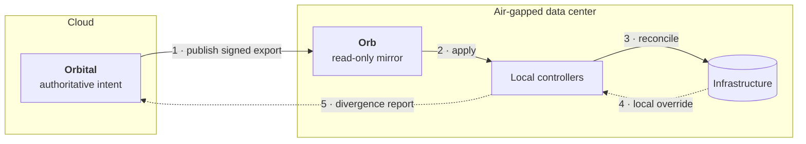

# Design intent

Orbital records what your infrastructure **should** be. It does not make it so.

That distinction shapes everything else in the system, so it is worth stating plainly before anything else.

## How it fits together

Solid arrows carry intent outward. Dotted arrows carry observations back. Nothing in the cloud reaches into the data center — the edge pulls, applies, and reports.

## Two kinds of fact

**Intent** is what you decided. A server should run this firmware. A cluster should back up on this schedule. Intent is authored in Orbital and nowhere else.

**Observed state** is what is actually true in a data center right now. It lives at the edge, where the hardware is.

The two are allowed to disagree. A disagreement is called [divergence](./divergence), and Orbital treats it as data rather than as an error.

## Orbital never reconciles

Orbital publishes intent. Local controllers in each data center pull that intent and apply it. Nothing in the cloud reaches into a data center to change it.

This is not a limitation that was worked around. It is the design.

A modular data center may be disconnected for hours or permanently. If the cloud were in the reconciliation path, every data center would stop converging the moment the link dropped. Keeping reconcilers local means a data center keeps working whether or not Orbital is reachable.

:::note
Orbital surfaces divergence for a human to resolve. It never silently corrects it. An automatic correction would overwrite a deliberate local decision that someone made for a reason Orbital cannot see.
:::

## What this rules out

| You want to | Orbital |
|---|---|
| Record what a server should be | ✅ This is its job |
| Query how infrastructure connects | ✅ The graph is traversable |
| See where reality has drifted | ✅ Divergence reports |
| Push a change to a machine now | ❌ Author intent; the edge pulls it |
| Reconcile drift automatically | ❌ Local controllers do that |
| Replace your DCIM or ITSM | ❌ Orbital references them |

## Composing with what you have

Orbital assumes you arrive with a stack. You already have identity, change management, monitoring, and probably a DCIM.

So Orbital authenticates against your identity provider rather than owning accounts. It references systems that own their own data rather than absorbing them. Its contract ends at an API boundary, and packaging and delivery past that point are yours.
